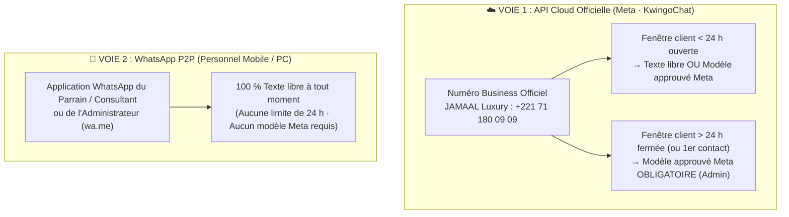
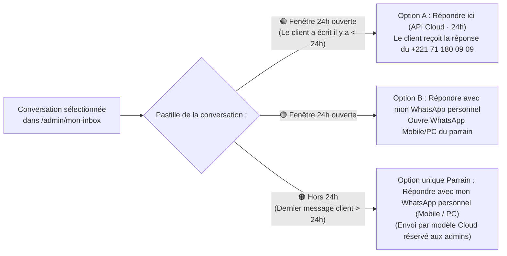

# Manuel Officiel — Messagerie & Notifications WhatsApp JAMAAL Luxury
*(Architecture hybride : Voie 1 « API Cloud Meta / KwingoChat » vs Voie 2 « WhatsApp P2P Personnel Mobile / PC »)*

---

## 1. Vue d'ensemble des deux voies WhatsApp

La plateforme **JAMAAL Luxury** repose sur une architecture WhatsApp à **double voie complémentaire**, permettant d'automatiser les flux officiels tout en laissant aux parrains/consultants et aux administrateurs la souplesse d'une relation directe de personne à personne (**P2P**).

### Tableau comparatif : Voie API Cloud vs Voie WhatsApp P2P

| Critère | ☁️ Voie 1 : API Cloud (`+221 71 180 09 09`) | 📱 Voie 2 : WhatsApp P2P (`wa.me` Mobile / PC) |
| :--- | :--- | :--- |
| **Expéditeur affiché chez le client** | Compte officiel **JAMAAL Luxury (`+221 71 180 09 09`)** | Le numéro WhatsApp personnel du **Parrain / Consultant** (ou de l'admin) |
| **Mode d'envoi** | Automatique en arrière-plan ou en 1 clic depuis l'interface JAMAAL (sans quitter la page) | Ouvre l'application WhatsApp installée sur le téléphone ou le PC avec le message pré-rempli |
| **Règle de la fenêtre de 24 heures** | **Oui (règle Meta)** : texte libre autorisé uniquement si le client a écrit depuis `< 24 h`. Au-delà de `24 h`, **Modèle approuvé Meta obligatoire** | **Aucune limite de 24 h** : envoi libre à tout moment, même 30 jours après |
| **Modèles utilizzables** | **Uniquement les Modèles approuvés par Meta** (`APPROVED`) hors 24 h, ou texte libre dans les 24 h | **Textes rapides internes JAMAAL** + tout texte libre personnalisé |
| **Qui peut l'utiliser hors fenêtre 24 h ?** | **Réservé aux Administrateurs** (envoi par modèle Cloud et campagnes) | **Parrains, Consultants et Administrateurs** |
| **Traçabilité dans JAMAAL** | Journalisé automatiquement dans la conversation JAMAAL & KwingoChat (`ENVOYE`, `LIVRE`, `LU`, `ECHEC`) | Conversation poursuivie en direct sur le WhatsApp de l'appareil du conseiller |

---

## 2. Matrice complète des flux : Quelle voie est utilisée pour chaque action ?

| Fonctionnalité / Notification | Voie utilisée | Règle d'envoi & Comportement |
| :--- | :--- | :--- |
| **1. Messages entrants des clients au `+221 71 180 09 09`** | ☁️ **API Cloud** | Reçus dans KwingoChat et synchronisés dans JAMAAL. **Routage dynamique automatique** vers l'inbox du parrain/consultant du client (`ROUTAGE_CLIENT`, `LIEN_BOUTIQUE`, `CAMPAGNE`), ou placés dans `Non assignés (unassigned)`. |
| **2. Formulaire « Contact » du site public (`/contact`)** | ☁️ **API Cloud** | Le message du visiteur (avec son numéro WhatsApp) crée ou alimente immédiatement une conversation dans la **Messagerie WhatsApp JAMAAL**, rattachée à son consultant s'il est déjà client, et déclenche une alerte WhatsApp à l'équipe. |
| **3. Réponse à un client dans la fenêtre de `< 24 h`** | ☁️ **API Cloud** *ou* 📱 **P2P** | Le parrain/consultant (sur `/admin/mon-inbox`) ou l'admin (sur `/admin/whatsapp/conversations`) a le **double choix** : • **Bouton vert « Répondre ici (API Cloud · 24h) »** (texte libre ou modèle Meta approuvé) • **Bouton « Répondre avec mon WhatsApp personnel (Mobile / PC) »** (P2P). |
| **4. Réponse à un client hors fenêtre de `> 24 h`** | 📱 **P2P (Consultant)** ☁️ **API Cloud (Admin)** | • **Pour le Parrain / Consultant** : le bouton API Cloud est masqué hors 24 h ; il répond via **« Répondre avec mon WhatsApp personnel (Mobile / PC) »** (P2P). • **Pour l'Administrateur** : peut soit envoyer un **Modèle approuvé par Meta** via l'API Cloud, soit répondre en P2P. |
| **5. Campagnes WhatsApp & Import Excel (`/admin/whatsapp/campagnes`)** | ☁️ **API Cloud** *(Admin)* | Envoi groupé via l'API Cloud avec un **Modèle approuvé par Meta** obligatoire. Les attributs de contact (`assigned_to`, `consultant_id`, `campaign_id`) sont posés à l'envoi pour que **chaque réponse client revienne automatiquement chez son consultant**. |
| **6. Annonces générales aux consultants (`/admin/annonces`)** | ☁️ **API Cloud** + 🔔 **Interne** | Publication dans `/admin/ma-communication` + cloche interne + diffusion automatique via la passerelle **API Cloud JAMAAL Luxury** à tous les consultants actifs. |
| **7. Annonces ciblées par statistiques (`/admin/boutiques-stats`)** | 🔔 **Interne** + 📱 **P2P** | Notification interne personnalisée (`{prenom}`, `{ventes}`, `{visiteurs}`) + liste de boutons **« Ouvrir WhatsApp » (P2P)** permettant d'envoyer le message individuel personnalisé à chaque revendeur sans contrainte de modèle Meta. |
| **8. Notifications transactionnelles automatiques (Commandes, Livreur, Relances, Kit du matin)** | ☁️ **API Cloud** | Partent automatiquement par l'API Cloud JAMAAL Luxury (`suivi`, `livreur`, `relance`, `avis`, `kit`, `resume`). Si la fenêtre 24 h du destinataire est fermée, la passerelle bascule automatiquement sur un modèle Meta approuvé du compte. |
| **9. Boutons « Commander sur WhatsApp » & Partage Boutique/Achat groupé** | 📱 **P2P** | Le client clique sur le site et ouvre son propre WhatsApp vers le numéro officiel `+221 71 180 09 09` (ou vers son revendeur sur `/c/<slug>`), ce qui **ouvre automatiquement une fenêtre de 24 h gratuite** côté API Cloud dès qu'il envoie son message ! |

---

## 3. Guide d'utilisation — Espace Parrain / Consultant (`/admin/mon-inbox`)

Accès : **`/admin/mon-inbox`** (*Menu latéral → Ventes → Messagerie WhatsApp JAMAAL*).

### 3.1. Quelles conversations apparaissent dans « Mon Inbox » ?
Un parrain ou consultant ne voit **que les conversations qui lui appartiennent**, issues de 4 sources affichées sous forme de badge sur chaque fil :
1. **`Retours campagne`** (`CAMPAGNE`) : un client a répondu à une campagne WhatsApp envoyée par l'administrateur ; grâce aux attributs de contact posés lors de la campagne, sa réponse arrive directement chez son consultant.
2. **`Client rattaché`** (`ROUTAGE_CLIENT`) : un client existant du consultant (commande précédente, fiche client, panier abandonné, abonnement, carte cadeau ou parrainage) a écrit spontanément au `+221 71 180 09 09`.
3. **`Lien boutique`** (`LIEN_BOUTIQUE`) : un prospect a envoyé un message contenant le lien ou le code de la boutique personnelle du consultant (`/c/<slug>` ou `?ref=<slug>`).
4. **`Assigné par admin`** (`MANUEL`) : un administrateur a attribué manuellement la conversation à ce consultant.

### 3.2. Comment répondre à un client depuis « Mon Inbox » ?

1. **Consulter les commandes du client sans quitter la conversation** :
   - Cliquez sur le bouton **`Commandes client (N)`** en haut à droite de la conversation pour déplier/replier les dernières commandes associées à ce numéro de téléphone.
2. **Utiliser le tiroir « Modèles de réponses rapides »** :
   - **Section 1 — `Modèles approuvés par Meta (Utilisables par API Cloud)`** : modèles validés par Meta (`test_lancement_produit`, `test_jamaal`, etc.). Compatibles avec le bouton **API Cloud** et avec le **WhatsApp personnel**.
   - **Section 2 — `Textes rapides internes JAMAAL (Non utilisables par API Cloud)`** : modèles de texte pré-rédigés pour gagner du temps, mais **non enregistrés comme templates chez Meta**.
     - Lorsqu'un texte rapide interne est sélectionné, un bandeau ambre vous rappelle qu'il n'est **pas utilisable pour un envoi par API Cloud**, désactive le bouton API Cloud, et vous invite à cliquer sur **« Répondre avec mon WhatsApp personnel (Mobile / PC) »**.

---

## 4. Guide d'utilisation — Back-office Administrateur (Les 4 pages WhatsApp)

L'espace WhatsApp Administrateur est organisé en **4 pages épurées**, reliées par une barre d'onglets commune en haut de l'écran :

### Onglet 1 : `1. Messagerie & Conversations` (`/admin/whatsapp/conversations`)
- **Mission** : Supervision globale et réponse aux conversations du numéro Business **`+221 71 180 09 09`**.
- **Filtres de supervision (colonne gauche)** :
  - **Tous (`N`)** : toutes les conversations reçues sur le numéro Business.
  - **Non assignés (`unassigned`)** : nouveaux prospects n'ayant encore aucun consultant rattaché.
  - **Menu déroulant par Parrain / Consultant** : inspecter la boîte de réception d'un consultant précis.
- **Attribution & Routage (en haut de la conversation active)** :
  - Le menu déroulant **`Assigné à : ...`** permet d'attribuer ou réattribuer manuellement une conversation à n'importe quel consultant actif (ou de la remettre dans `Non assigné / unassigned`).
  - Le bouton **`Auto-router`** relance la détection automatique du consultant à partir de l'historique de commandes et du texte du client.
  - Le bouton **`Pause IA 2h` / `Relancer l'IA`** met en pause ou réactive l'assistant automatique sur ce fil.
- **Connexion KwingoChat** :
  - Le bouton **`Connecter KwingoChat / Jamaal Luxury`** en haut à droite demande uniquement l'**Email** et le **Mot de passe KwingoChat**. La session est chiffrée en `AES-256-GCM` dans la base et rafraîchie automatiquement.

---

### Onglet 2 : `2. Campagnes & Import Excel` (`/admin/whatsapp/campagnes`)
*(Strictement réservé aux Administrateurs — Envoi 100 % Voie API Cloud)*

1. **Section « Brouillons prêts à lancer » (en haut de page)** :
   - Créez autant de brouillons que nécessaire pour préparer vos opérations commerciales à l'avance.
   - Sur chaque carte de brouillon, 4 actions à la volée :
     - **▶ Lancer maintenant** : démarre immédiatement l'envoi par lots via l'API Cloud.
     - **✏️ Modifier** : recharge le brouillon (modèle Meta, filtres et liste Excel incluse) dans le constructeur.
     - **📋 Dupliquer** : clone le brouillon en 1 clic pour préparer un autre segment.
     - **🗑️ Supprimer** : supprime le brouillon à la volée.
2. **Constructeur de campagne en 3 étapes** :
   - **Étape 1 — Choisir un modèle approuvé par Meta** : sélection obligatoire parmi les modèles Meta réellement approuvés sur le compte Jamaal Luxury (`test_lancement_produit`, `test_jamaal`, `test_appointement`, `test_san_param`).
   - **Étape 2 — Sélectionner les destinataires** :
     - **A. Filtres de la base JAMAAL** : *Clients* ou *Revendeurs actifs*, *Sans commande depuis N jours*, *Catégorie achetée*, *Clients d'un revendeur*.
     - **B. Importer une liste Excel (`.xlsx`, `.xls`) ou CSV (`.csv`)** :
       - Reconnaissance automatique des colonnes **Téléphone / WhatsApp / Numéro**, **Nom / Prénom** et **Consultant / Parrain** (même sans ligne d'en-tête).
       - Normalisation internationale (`+221…`), dédoublonnage sur les 9 derniers chiffres, exclusion automatique des clients ayant répondu **STOP** (`whatsappOptOut`), et **rattachement automatique de chaque numéro à son consultant** en base.
       - 3 modes au choix : *Uniquement la liste Excel*, *Combiner Filtres + Excel*, ou *Uniquement les filtres*.
   - **Étape 3 — Aperçu & Envoi / Enregistrement en brouillon** :
     - Affiche le nombre exact de destinataires uniques et la répartition du routage des retours (*rattachés à un consultant* vs `unassigned`).

---

### Onglet 3 : `3. Centre & Modèles Meta` (`/admin/whatsapp`)
- **Mission** : Cockpit de synthèse et gestion des modèles.
- **4 cartes KPI cliquables** : *Conversations actives*, *Non assignées (`unassigned`)*, *Modèles approuvés Meta*, *Messages envoyés sur 7 jours*.
- **Répertoire des Modèles approuvés par Meta** : affiche tous les modèles synchronisés depuis KwingoChat (`GET /api/v1/templates/sync`) avec un bouton **`Utiliser dans une campagne →`** sur chaque modèle.
- **Export Catalogue Produits CSV (Meta)** : télécharge le flux CSV officiel pour Meta Commerce Manager.
- **Textes des messages automatiques JAMAAL** : éditeur permettant de personnaliser les textes des notifications automatiques (*Suivi de commande, Bienvenue, Relance J+45, Anniversaire, Panier abandonné, Kit du matin*).

---

### Onglet 4 : `4. Journal & Diagnostic` (`/admin/journal-whatsapp`)
- **Mission** : Supervision technique de la passerelle API Cloud et historique d'envoi.
- **Diagnostic sur 7 jours** : compteurs *Acceptés par Meta*, *Livrés ou lus*, *En échec* (avec diagnostic de la cause et solution), *Simulés*.
- **Formulaire « Envoyer un message de test »** : permet de tester instantanément la livraison API Cloud vers un numéro international (ex. `221775690348`).
- **Historique des 100 derniers messages** : journal complet de tous les messages entrants (`←`) et sortants (`→`) avec bouton **`Renvoyer`** sur tout message en échec.

---

## 5. Règles d'or pour éviter toute erreur Meta API Cloud

1. **Pourquoi l'erreur `Meta API Error 132001 (Template name does not exist in the translation)` survient-elle chez Meta ?**
   - Elle survient lorsqu'on demande à Meta d'envoyer un modèle (`type: "template"`) dont le nom ou le code langue (`fr`, `en_US`, `en`) n'est pas déclaré et approuvé (`APPROVED`) dans le WhatsApp Business Manager du compte **Jamaal Luxury**.
2. **Comment la passerelle JAMAAL vous protège désormais automatiquement** :
   - Les modèles proposés dans la section **« 1. Modèles approuvés par Meta »** sont synchronisés directement depuis la route **`GET /api/v1/templates/sync`** de KwingoChat avec leur couple exact `(templateName, language)`.
   - Les **Textes rapides internes JAMAAL** sont clairement marqués **`⚠️ Non utilisables par API Cloud`** et verrouillent le bouton d'envoi API Cloud lorsqu'ils sont sélectionnés, afin d'être utilisés uniquement via le bouton **WhatsApp P2P personnel**.
   - Si un envoi automatique ou manuel appelle un modèle non reconnu alors que la **fenêtre de 24 h est ouverte**, la passerelle bascule automatiquement l'envoi en **message texte libre Cloud API (`type: "text"`)**. Si la **fenêtre de 24 h est fermée**, elle sélectionne automatiquement le premier modèle français réellement approuvé du compte (`test_jamaal` / `test_lancement_produit`).
